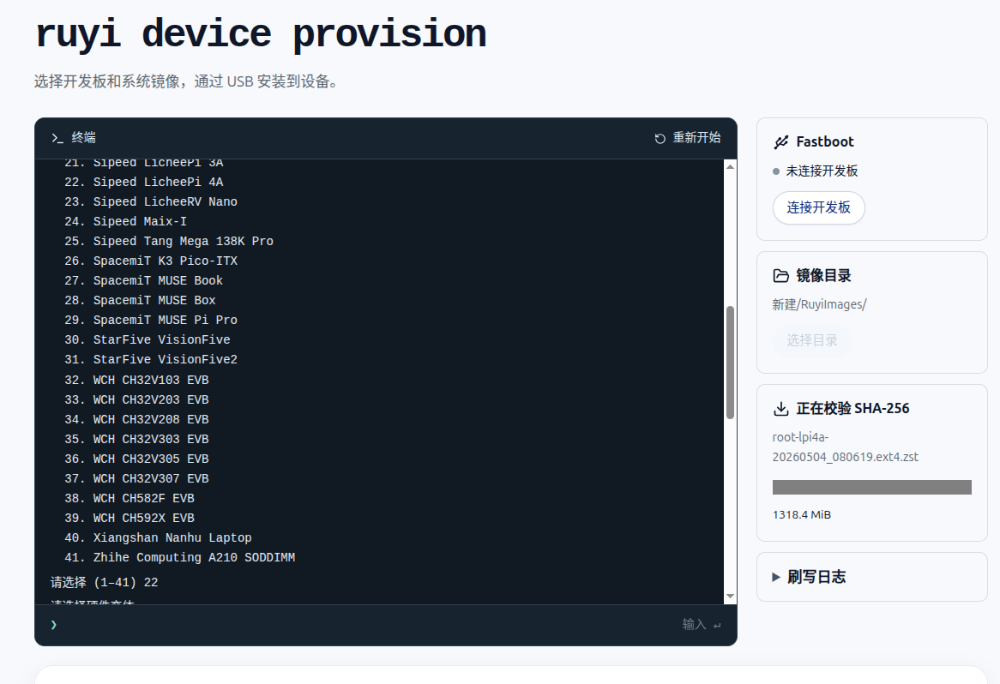
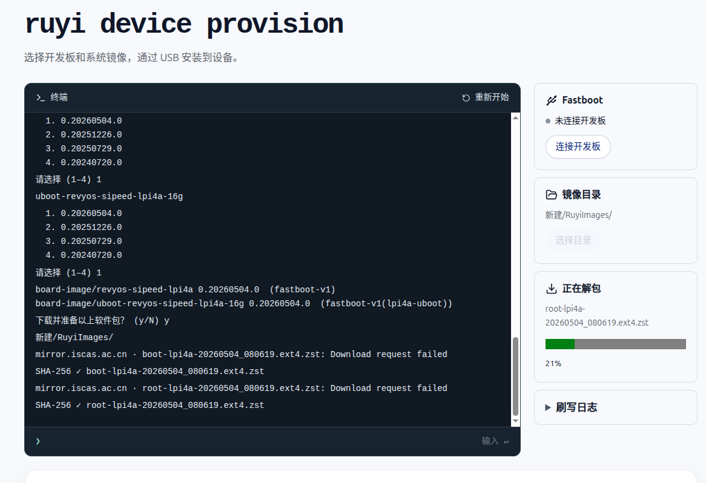
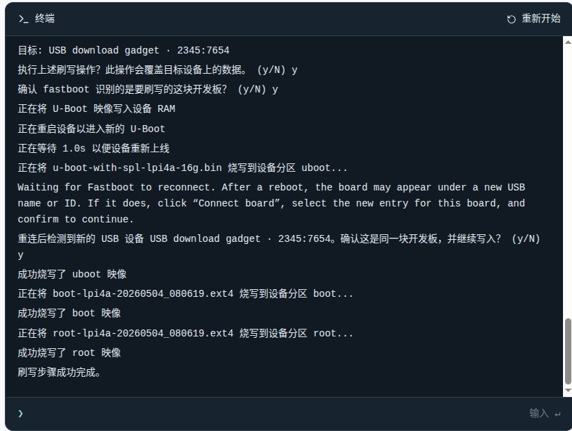
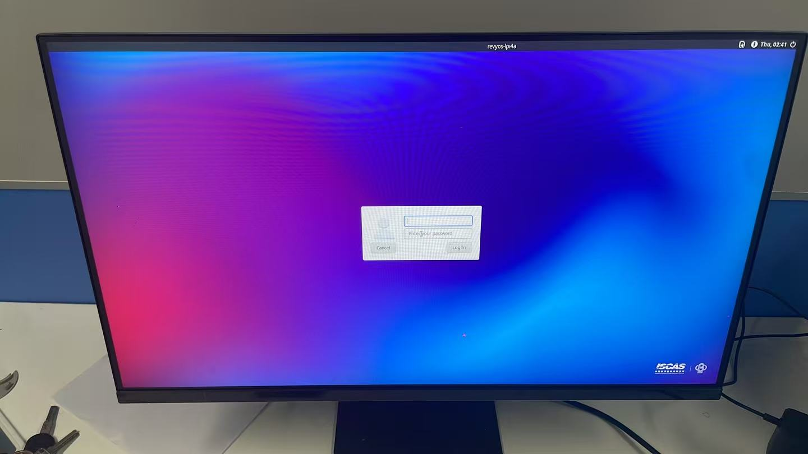

# ruyi device provision烧录Licheepi4A 

ruyisdk website [刷机网址](https://ruyisdk.org/tryruyi/device/)

刷机前试一下 fastboot devices 如果需要提权，配置一下udev [教程链接](https://ruyisdk.org/docs/Package-Manager/cases/case4)

按图片顺序依次操作即可

 

 

 

 

目前网站刷机仅支持fastboot 支持的开发板有Licheepi 4A，Licheepi 3A，K1,K3等
